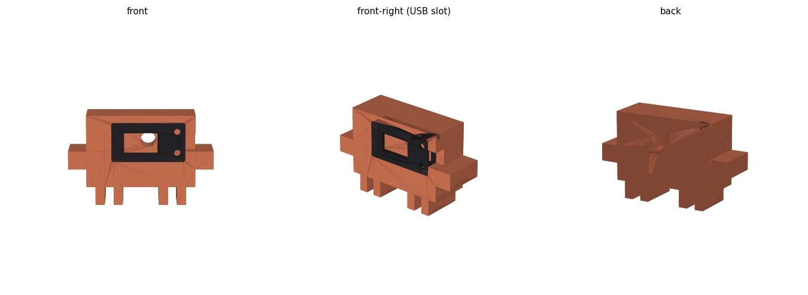

# Claude Code 用量顯示器（LILYGO T-Display V1.1 + Clawd 外殼）

把 Claude Code 的 **5 小時 session 用量** 和 **每週用量** 即時顯示在 LILYGO T-Display V1.1
的小螢幕上，再把開發板裝進 Clawd（Claude 吉祥物）3D 列印模型的眼睛位置。

```
USB  模式（預設）: usage_bridge.py (電腦) ──USB 序列埠──> T-Display
WiFi 模式        : T-Display ──WiFi，每 60 秒──> api.anthropic.com     （USB 只供電）
```

## 目錄

- [硬體與軟體需求](#硬體與軟體需求)
- [資料夾內容](#資料夾內容)
- [畫面與按鈕](#畫面與按鈕)
- [WiFi 模式](#wifi-模式)
- [取得 Claude token（Windows / macOS / Linux）](#取得-claude-tokenwindows--macos--linux)
- [USB 模式](#usb-模式)
- [用量資料從哪裡來](#用量資料從哪裡來)
- [燒錄韌體](#燒錄韌體)
- [還原原本的韌體](#還原原本的韌體)
- [3D 列印外殼](#3d-列印外殼)
- [疑難排解](#疑難排解)
- [來源與授權](#來源與授權)

## 硬體與軟體需求

| 項目 | 說明 |
|---|---|
| 開發板 | LILYGO T-Display V1.1（ESP32、1.14 吋 ST7789 135×240） |
| 連接埠 | Windows 為 `COMx`（本文以 COM3 為例）、macOS 為 `/dev/cu.wchusbserial*`、Linux 為 `/dev/ttyACM0` |
| Python | 3.11，需要 `pip install pyserial`（macOS / Linux 用 `python3 -m pip install pyserial`） |
| Claude Code | 已安裝並登入（`claude` 指令），取得 token 時會用到 |
| 韌體編譯 | PlatformIO（`pip install platformio`），平台 espressif32@6.9.0 |
| 韌體函式庫 | TFT_eSPI 2.5.43、ArduinoJson 7.2.1（PlatformIO 會自動下載） |
| 3D 模型產生 | `pip install numpy manifold3d matplotlib`（只有要重新產生模型時才需要） |
| 3D 列印 | Bambu Studio 開啟產生的 `3D/Clawd_TDisplay.3mf`（見 [3D 列印外殼](#3d-列印外殼)） |

## 資料夾內容

```
token/
  get_token.py             取得 token、驗證、寫進板子（三個系統共用）
  get_token_windows.bat    Windows 雙擊執行
  get_token_macos.command  macOS 在 Finder 雙擊執行
  get_token_linux.sh       Linux 執行

tdisplay_usage/
  usage_bridge.py        USB 模式：電腦端查詢用量並經序列埠傳給板子
  start_bridge.bat       雙擊執行 usage_bridge.py
  provision.py           經 USB 把 WiFi / token 寫進板子、查看狀態
  firmware/
    platformio.ini       PlatformIO 設定（板子腳位、序列埠）
    src/main.cpp         韌體主程式
    src/root_ca.h        HTTPS 用的 Google Trust Services 根憑證
  backup/                燒錄前自己備份的原廠韌體（不在 repo 裡，見「還原原本的韌體」）

3D/
  Claude.3mf                   Clawd 原始模型（授權不允許轉發，需自行下載，見下方）
  TTGO_-_Tdisplay_lid.3mf      T-Display 外殼原始模型（CC0）
  build_clawd_tdisplay.py      把兩者合併的腳本
  Clawd_TDisplay.3mf           合併後的成品（執行腳本後產生），直接拿去切片
  Clawd_TDisplay_preview.png   組裝示意圖
```

## 畫面與按鈕

```
┌────────────────────────────────────────┐
│ Claude Code usage          [圖示] 14:32 │
├────────────────────────────────────────┤
│ 5h session                         4%  │
│ reset 3h 12m                           │
│ ████░░░░░░░░░░░░░░░░░░░░░░░░░░░░░░░░░░ │
│ Weekly                            72%  │
│ reset 2d 5h                            │
│ ███████████████████████████░░░░░░░░░░░ │
│ updated 12s ago                        │
└────────────────────────────────────────┘
```

- **上方區塊**：5 小時 session 用量與距離重置的時間
- **下方區塊**：每週用量與距離重置的時間
- **顏色**：綠色 < 70%、橘色 < 90%、紅色 ≥ 90%
- **右上角**：時鐘，左邊是目前模式的圖示（USB-C 接口 = USB 模式、WiFi 扇形 = WiFi 模式）。
  圖示**白色**表示連線正常、資料是新的；**灰色**表示未連線或資料過期
- **底部狀態列**：最後更新時間；超過 3 分鐘沒更新會以紅字顯示原因；
  快到上限顯示 `approaching limit`，已達上限顯示 `LIMIT REACHED`

| 按鈕 | 動作 |
|---|---|
| **左鍵**（GPIO0） | 開關背光 |
| **右鍵**（GPIO35）短按 | 切換 USB / WiFi 模式（放開時切換） |
| **右鍵**長按 5 秒 | 清除 WiFi 設定並顯示設定用 QR code（按住時畫面底部會倒數） |

出廠預設為 USB 模式；之後板子會記住最後選的模式，重新開機也一樣。

## WiFi 模式

板子自己連上 WiFi，每 60 秒查詢一次，電腦不用開，USB 線只負責供電。
WiFi 帳密和 token 存在板子的 NVS（內部儲存），不在原始碼裡。

WiFi 模式需要兩樣東西：**WiFi 設定** 和 **Claude token**。

### 1. 設定 WiFi：用手機掃 QR code

板子還沒有 WiFi 設定時，切到 WiFi 模式就會自動進入設定畫面；
已經設定過、要換新網路時，**長按右鍵 5 秒**。

1. 畫面先顯示 `Scanning WiFi...`，幾秒後左邊出現 QR code，右邊顯示熱點名稱
   `ClaudeUsage-XXXX`、熱點密碼與 `192.168.4.1`
2. 用手機相機掃 QR code → 加入熱點（熱點密碼每次隨機產生，已包含在 QR code 裡）
3. 手機連上後，板子上的 `Scan with phone` 會變成綠色的 `Phone connected`
4. 手機通常會自動跳出設定頁（Android 可能是「登入網路」通知，點它即可）；
   沒有的話用瀏覽器開 **`http://192.168.4.1`**。若手機提示「無法連上網際網路」，選擇保持連線
5. 在清單中點選要連接的 WiFi（名稱會自動填入），輸入 **WiFi 密碼**
6. Claude token 欄位**選填**：留空表示保留板子上原本的 token
7. 按「**儲存並連線**」→ 板子重新開機並連線，10–20 秒後顯示用量
8. 手機切回原本的 WiFi

注意：

- 掃 QR code 只是讓手機加入板子的熱點，**不會**自動帶入手機正在用的 WiFi，
  WiFi 名稱要在清單點選、密碼要自己輸入
- 只支援 **2.4GHz** WiFi；5GHz 的網路不會出現在清單裡
- 設定頁的清單是開熱點前掃描的結果，找不到網路可以按「重新掃描」，或直接手動輸入名稱
- 在設定畫面短按右鍵會切回 USB 模式

### 1'. 設定 WiFi：用電腦（USB）

```
cd tdisplay_usage
python provision.py --wifi "WiFi名稱" "WiFi密碼"
```

### 2. 設定 Claude token（只需一次）

用 `token/` 資料夾的程式最簡單，見下一節
[取得 Claude token](#取得-claude-tokenwindows--macos--linux)。它會執行 `claude setup-token`、
驗證 token，然後直接寫進板子。

也可以手動做：

```
claude setup-token                 # 瀏覽器登入，產生板子專用的長期 token
cd tdisplay_usage
python provision.py --token        # 貼上上一步的 token（輸入時不會顯示）
```

或在手機設定頁的 token 欄位貼上。長按右鍵重設 WiFi **不會**清掉 token。

### 檢查狀態

```
cd tdisplay_usage
python provision.py --status
```

回傳一行 JSON（不含 token），例如：

```json
{"mode":"wifi","ssid":"MyWiFi","portal":false,"wifi_status":3,"ip":"192.168.1.50",
 "rssi":-41,"token_set":true,"time_ok":true,"last_http":200,"err":"","data":true,"s":4,"w":72,"age_s":9}
```

| 欄位 | 意義 |
|---|---|
| `mode` | `wifi` / `usb` |
| `portal` | `true` = 正在顯示 QR code 設定畫面 |
| `wifi_status` | `3` 已連線、`1` 找不到 SSID、`4` 連線失敗、`6` 未連線 |
| `token_set` | 板子上是否有 token |
| `time_ok` | NTP 對時是否完成（HTTPS 驗證憑證需要正確時間） |
| `last_http` | 最近一次查詢的 HTTP 狀態碼（200 = 正常） |
| `s` / `w` | 5 小時 / 每週用量百分比 |
| `age_s` | 資料是幾秒前取得的 |

其他指令：`python provision.py --clear-wifi` 清除板子上的 WiFi 帳密（效果同長按右鍵）。

## 取得 Claude token（Windows / macOS / Linux）

`token/get_token.py` 是三個系統共用的程式，各系統都有一個啟動檔。
板子用 USB 接在**執行程式的這台電腦**上，就會自動寫入。

### 兩種 token 的差別

| | setup-token（板子用） | Claude Code 登入 token（USB 模式用） |
|---|---|---|
| 怎麼來 | `claude setup-token` 產生 | 執行 `claude` 登入時自動產生 |
| 有效期 | 長期 | 幾小時，Claude Code 會自動續期 |
| 存放位置 | 只存在板子的 NVS | Windows / Linux：`~/.claude/.credentials.json`<br>macOS：鑰匙圈的 `Claude Code-credentials` |
| 用途 | **WiFi 模式**，寫進板子 | **USB 模式**，`usage_bridge.py` 自動讀取 |

**不要**把 Claude Code 的登入 token 寫進板子：它很快過期，而且板子若自行續期，
會讓電腦上的 Claude Code 被登出。

### Windows

1. 板子用 USB 接上電腦；若 `start_bridge.bat` 開著，先關掉（它會占用 COM3）
2. 雙擊 `token\get_token_windows.bat`
3. 按 Enter → 瀏覽器開啟 Claude 登入頁，登入並授權
4. 終端機印出 `sk-ant-oat` 開頭的 token，把整串複製起來
5. 回到視窗貼上（不會顯示），按 Enter
6. 程式驗證 token（顯示目前 5 小時 / 每週用量），然後寫進板子，板子自動重開機

在命令列加參數：`token\get_token_windows.bat --local`

### macOS

第一次使用先安裝 pyserial、給啟動檔執行權限：

```
cd token
python3 -m pip install pyserial
chmod +x get_token_macos.command
```

之後在 Finder 雙擊 `get_token_macos.command`（或在終端機執行 `./get_token_macos.command`），
步驟同 Windows 的 3–6。

- 板子的序列埠是 `/dev/cu.wchusbserial*` 或 `/dev/cu.usbserial*`；找不到的話要安裝
  WCH 的 CH34x / CH9102 驅動
- `--local` 讀取鑰匙圈時，macOS 會詢問是否允許 `security` 存取，選「允許」
- 若驗證時出現 SSL 憑證錯誤，執行 `/Applications/Python 3.x/Install Certificates.command`

### Linux

```
cd token
python3 -m pip install pyserial        # 或用套件管理員安裝 python3-serial
chmod +x get_token_linux.sh
./get_token_linux.sh
```

步驟同 Windows 的 3–6。

- 板子的序列埠通常是 `/dev/ttyACM0` 或 `/dev/ttyUSB0`
- 出現序列埠權限錯誤時：`sudo usermod -aG dialout $USER`，登出再登入

### 參數

三個啟動檔都可以加以下參數（等同 `python get_token.py ...`）：

| 參數 | 說明 |
|---|---|
| （無） | 執行 `claude setup-token` → 貼上 → 驗證 → 寫入板子 |
| `--skip-setup` | 已經有 setup-token 產生的 token，直接貼上（例如之前寫入失敗，要重寫） |
| `--no-write` | 只取得並驗證，不寫入板子（板子沒接在這台電腦時，之後可在手機設定頁貼上） |
| `--local` | 查看這台電腦 Claude Code 的登入 token：來源、遮蔽後的 token、訂閱類型、到期時間、查詢測試 |
| `--port 埠名` | 指定序列埠，例如 `COM3`、`/dev/cu.wchusbserial110`、`/dev/ttyACM0` |

token 只在記憶體中處理，不會存檔，也不會完整印出（只顯示前 14 碼和末 4 碼）。

## USB 模式

由電腦查詢用量，再經 USB 傳給板子。用的是電腦上 Claude Code 的登入
（Windows / Linux：`~/.claude/.credentials.json`；macOS：鑰匙圈），不需要另外設定 token。
此模式下板子的 WiFi 關閉。可用 `token/get_token.py --local` 確認電腦上的登入是否有效。

1. 板子切到 USB 模式（右上角顯示 USB-C 圖示）
2. 雙擊 `tdisplay_usage/start_bridge.bat`，**視窗保持開著**
   （macOS / Linux：`python3 tdisplay_usage/usage_bridge.py`）
3. 視窗每 60 秒顯示一次查詢結果，例如 `[14:32:05] 5h 4%  每週 72%  (allowed)`

- `start_bridge.bat` 執行期間會**占用 COM3**；要執行 `provision.py` 或燒錄韌體前，先關掉它的視窗
- 只想測試查詢、不連板子：`python usage_bridge.py --once`
- 指定序列埠：`python usage_bridge.py --port COM3`（預設自動偵測 CH9102/CP210x）
- 板子沒收到資料時顯示 `Waiting for PC...`；電腦查詢失敗時顯示 `Query failed - see PC`，
  原因看 `start_bridge.bat` 的視窗

## 用量資料從哪裡來

不論哪種模式，都是向 `https://api.anthropic.com/v1/messages` 送出一個 **1 token** 的極小請求
（模型 claude-haiku-4-5），只讀回應中的 rate-limit 標頭：

| 標頭 | 顯示 |
|---|---|
| `anthropic-ratelimit-unified-5h-utilization` / `-reset` | 5 小時 session 用量 / 重置時間 |
| `anthropic-ratelimit-unified-7d-utilization` / `-reset` | 每週用量 / 重置時間 |
| `anthropic-ratelimit-unified-5h-status` | `allowed` / `allowed_warning` / `rejected` |

- 查詢間隔 60 秒，失敗後 15 秒重試；每次都是真實請求，不建議調得更短
- 調整位置：韌體 `firmware/src/main.cpp` 的 `POLL_MS` / `RETRY_MS`；
  電腦端 `usage_bridge.py` 的 `POLL_INTERVAL` / `RETRY_INTERVAL`
- 時區在 `main.cpp` 的 `TZ_INFO`（預設台灣 `CST-8`）
- 板子以內建的 Google Trust Services 根憑證（`root_ca.h`）驗證 HTTPS

## 燒錄韌體

先關掉 `start_bridge.bat`（會占用 COM3），然後：

```
cd tdisplay_usage/firmware
python -m platformio run -t upload
```

- `platformio.ini` 固定使用 COM3、上傳速度 921600；你的開發板不是 COM3 的話，
  修改 `upload_port` / `monitor_port`（或刪掉這兩行讓 PlatformIO 自動偵測）
- 一般燒錄**不會**清掉 NVS，WiFi、token、模式設定都會保留
- 只編譯不燒錄：`python -m platformio run`

## 還原原本的韌體

建議第一次燒錄前先備份整片 4MB flash（備份含裝置資料，不要上傳到公開的地方；
`.gitignore` 已排除 `backup/`）：

```
cd tdisplay_usage
python -m esptool --port COM3 read-flash 0 0x400000 backup/tdisplay_original_flash.bin
```

要還原時：

```
python -m esptool --port COM3 write-flash 0 backup/tdisplay_original_flash.bin
```

## 3D 列印外殼

`build_clawd_tdisplay.py` 把 T-Display 外殼嵌進 Clawd 的眼睛位置，輸出 `3D/Clawd_TDisplay.3mf`，
用 Bambu Studio 開啟切片。

### 先取得 Clawd 模型

Clawd 模型的授權是 MakerWorld Exclusive License，**不允許轉發**，所以本 repo 不含它，
也不含用它合併出來的 `Clawd_TDisplay.3mf`。請自己下載後產生：

1. 到 MakerWorld 搜尋「**Clawd the Claude Code mascot (AMS print-in-place)**」（作者 h2d2），
   下載 3MF，存成 `3D/Claude.3mf`
2. `pip install numpy manifold3d matplotlib`
3. `cd 3D` → `python build_clawd_tdisplay.py`，產生 `Clawd_TDisplay.3mf`

T-Display 外殼 `TTGO_-_Tdisplay_lid.3mf` 是 CC0 授權，已附在 repo 裡。



### 檔案內的 5 個零件（已擺好列印方向）

| 零件 | 說明 |
|---|---|
| `Clawd_body` | Clawd 本體，臉朝上列印，不需支撐 |
| `TDisplay_front_shell` | T-Display 前殼 |
| `TDisplay_back_cover` | T-Display 後蓋（已翻面） |
| `TDisplay_button_1` / `_2` | 兩顆按鈕（已翻面） |

### 設計重點

- Clawd 放大為 **112 × 70 × 33.6 mm**（XY 0.7 倍、Z 0.84 倍），臉部才放得下外殼
- 原本的眼睛凹洞已填平，改挖一個放外殼的口袋：外殼外型 56.7 × 30.3 × 14 mm，
  四個角為 **R2.2 圓角**（外殼本身是 R2.0），每邊間隙 0.2 mm
- 外殼從正面壓入，正面比臉內縮 0.2 mm，螢幕置中
- 右側開槽讓 USB-C 線出去；背面有 Ø12 mm 圓孔，方便把外殼頂出來

### 組裝

1. 把 T-Display 裝進前殼，裝上按鈕，蓋上後蓋
2. USB-C 接口朝右，從 Clawd 正面把整個外殼壓進口袋
3. USB 線從右側的槽穿出
4. 要拆時從背面圓孔把外殼頂出來

### 調整並重新產生

可調參數在 `3D/build_clawd_tdisplay.py` 開頭：

| 參數 | 預設 | 說明 |
|---|---|---|
| `CLEARANCE` | 0.2 | 口袋每邊間隙；壓不進去就加大到 0.25–0.3 |
| `POCKET_EXTRA_DEPTH` | 0.2 | 外殼正面內縮量 |
| `SCALE_XY` / `SCALE_Z` | 0.7 / 0.84 | Clawd 縮放比例 |
| `USB_SLOT_W` / `USB_SLOT_H` | 14.0 / 10.4 | USB 槽大小 |
| `PUSH_HOLE_D` | 12.0 | 背面頂出孔直徑 |

```
cd 3D
python build_clawd_tdisplay.py
```

會覆寫 `Clawd_TDisplay.3mf` 與 `Clawd_TDisplay_preview.png`。

> 畫面方向目前是 `tft.setRotation(1)`。若裝進 Clawd 後畫面上下顛倒，改成 `setRotation(3)`
> 重新燒錄（左右按鈕的實體位置也會對調）。

## 疑難排解

| 畫面 / 狀況 | 原因與處理 |
|---|---|
| `Connecting WiFi...` 一直不消失 | WiFi 名稱或密碼錯、或是 5GHz 網路 → 長按右鍵 5 秒重新設定 |
| `WiFi OK - token missing` | 板子沒有 token → 執行 `token/` 的取得程式，或在手機設定頁填入 |
| `Token rejected (HTTP 401)` | token 失效 → 重新執行 `token/` 的取得程式寫入新 token |
| `Syncing time...` | 等待 NTP 對時，通常幾秒內完成；若卡住，檢查網路是否能連外 |
| 手機沒有自動跳出設定頁 | 用瀏覽器開 `http://192.168.4.1`；若手機開了「私人 DNS」可能不會自動跳出 |
| USB 模式顯示 `Waiting for PC...` | 沒有執行 `start_bridge.bat`，或板子不在 USB 模式 |
| 從 WiFi 切回 USB 沒有資料 | 確認 `start_bridge.bat` 正在執行 |
| `provision.py` / 燒錄失敗：無法開啟 COM3 | `start_bridge.bat` 還開著，先關掉 |

## 來源與授權

- 程式碼採 MIT 授權，見 [LICENSE](LICENSE)。用量查詢的做法移植自
  [juppeee/claude-session-browser](https://github.com/juppeee/claude-session-browser)（MIT）
- Clawd 3D 模型：MakerWorld「Clawd the Claude Code mascot (AMS print-in-place)」，作者 h2d2，
  MakerWorld Exclusive License，僅供個人使用；本 repo 不含該模型及其衍生的 3MF，請勿轉發
- T-Display 外殼：MakerWorld「Enclosure TTGO T-display 1.14"」，作者 3D maker，CC0
- Clawd 是 Anthropic 的吉祥物，其形象不在 MIT 授權範圍內
