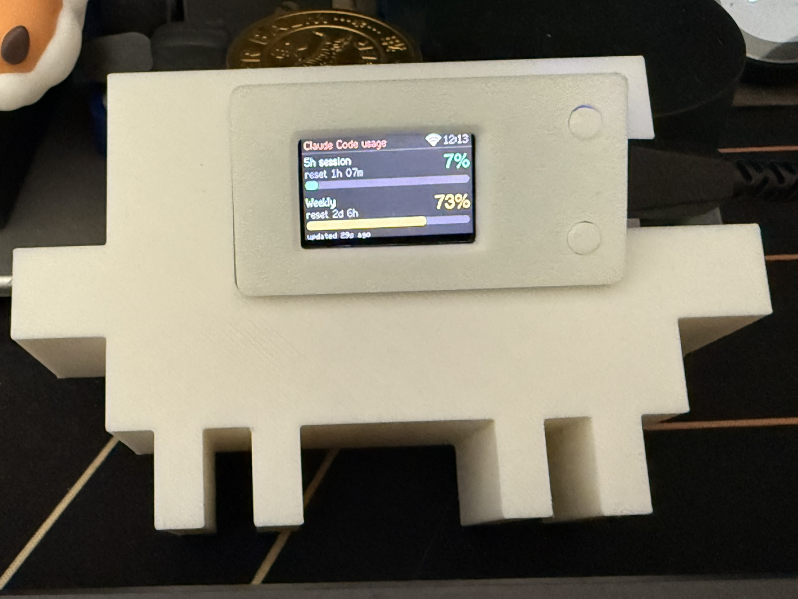
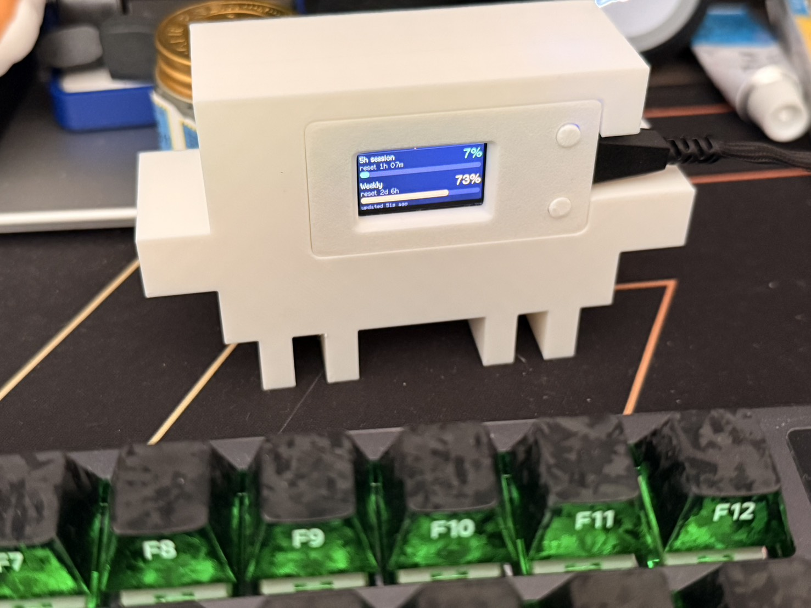

# Claude Code Usage Display (LILYGO T-Display V1.1 + Clawd enclosure)

[](LICENSE)

Shows your Claude Code **5-hour session usage** and **weekly usage** live on the small screen of a
LILYGO T-Display V1.1, with the board mounted in the eye area of a 3D-printed Clawd (the Claude mascot).

```
USB  mode (default): usage_bridge.py (computer) ──USB serial──> T-Display
WiFi mode          : T-Display ──WiFi, every 60 s──> api.anthropic.com     (USB for power only)
```

## Showcase

<p align="center">
  
  
</p>

The T-Display sits in the eye area of the 3D-printed Clawd, with the USB-C cable leaving through a slot on
the right side; in WiFi mode it only needs power. The top of the screen shows the 5-hour session usage
(7%, resets in 1 h 07 min), the bottom shows the weekly usage (73%, resets in 2 days 6 h).

## Contents

- [Showcase](#showcase)
- [Hardware and software requirements](#hardware-and-software-requirements)
- [Repository layout](#repository-layout)
- [Screen and buttons](#screen-and-buttons)
- [WiFi mode](#wifi-mode)
- [Getting a Claude token (Windows / macOS / Linux)](#getting-a-claude-token-windows--macos--linux)
- [USB mode](#usb-mode)
- [Where the usage data comes from](#where-the-usage-data-comes-from)
- [Flashing the firmware](#flashing-the-firmware)
- [Restoring the original firmware](#restoring-the-original-firmware)
- [3D-printed enclosure](#3d-printed-enclosure)
- [Troubleshooting](#troubleshooting)
- [Credits and license](#credits-and-license)

## Hardware and software requirements

| Item | Details |
|---|---|
| Board | LILYGO T-Display V1.1 (ESP32, 1.14" ST7789 135×240) |
| Serial port | Windows: `COMx` (this guide uses COM3 as the example), macOS: `/dev/cu.wchusbserial*`, Linux: `/dev/ttyACM0` |
| Python | 3.11, needs `pip install pyserial` (macOS / Linux: `python3 -m pip install pyserial`) |
| Claude Code | Installed and logged in (`claude` command); needed to get a token |
| Firmware build | PlatformIO (`pip install platformio`), platform espressif32@6.9.0 |
| Firmware libraries | TFT_eSPI 2.5.43, ArduinoJson 7.2.1 (downloaded automatically by PlatformIO) |
| 3D model generation | `pip install numpy manifold3d matplotlib` (only needed to regenerate the model) |
| 3D printing | Open the generated `3D/Clawd_TDisplay.3mf` in Bambu Studio (see [3D-printed enclosure](#3d-printed-enclosure)) |

## Repository layout

```
token/
  get_token.py             Get a token, verify it, write it to the board (shared by all three OSes)
  get_token_windows.bat    Windows: double-click to run
  get_token_macos.command  macOS: double-click in Finder to run
  get_token_linux.sh       Linux: run from a terminal

tdisplay_usage/
  usage_bridge.py        USB mode: the computer queries usage and sends it to the board over serial
  start_bridge.bat       Double-click to run usage_bridge.py
  provision.py           Write WiFi / token to the board over USB, show board status
  firmware/
    platformio.ini       PlatformIO config (board pins, serial port)
    src/main.cpp         Main firmware
    src/root_ca.h        Google Trust Services root certificates for HTTPS
  backup/                Your own backup of the factory firmware (not in the repo, see "Restoring the original firmware")

img/                           Showcase photos

3D/
  Claude.3mf                   Original Clawd model (license forbids redistribution; download it yourself, see below)
  TTGO_-_Tdisplay_lid.3mf      Original T-Display enclosure model (CC0)
  build_clawd_tdisplay.py      Script that merges the two
  Clawd_TDisplay.3mf           Merged result (generated by the script), ready to slice
  Clawd_TDisplay_preview.png   Assembly preview
```

## Screen and buttons

```
┌────────────────────────────────────────┐
│ Claude Code usage          [icon] 14:32 │
├────────────────────────────────────────┤
│ 5h session                         4%  │
│ reset 3h 12m                           │
│ ████░░░░░░░░░░░░░░░░░░░░░░░░░░░░░░░░░░ │
│ Weekly                            72%  │
│ reset 2d 5h                            │
│ ███████████████████████████░░░░░░░░░░░ │
│ updated 12s ago                        │
└────────────────────────────────────────┘
```

- **Top block**: 5-hour session usage and time until it resets
- **Bottom block**: weekly usage and time until it resets
- **Colors**: green < 70%, orange < 90%, red ≥ 90%
- **Top right**: clock, with the current mode's icon to its left (USB-C port = USB mode, WiFi fan = WiFi mode).
  A **white** icon means the connection is fine and the data is fresh; **grey** means not connected or stale data
- **Bottom status line**: time since the last update; if there has been no update for more than 3 minutes
  the reason is shown in red; near the limit it shows `approaching limit`, at the limit `LIMIT REACHED`

| Button | Action |
|---|---|
| **Left button** (GPIO0) | Toggle the backlight |
| **Right button** (GPIO35) short press | Switch between USB / WiFi mode (switches on release) |
| **Right button** hold for 5 s | Clear the WiFi settings and show the setup QR code (a countdown appears at the bottom while holding) |

The factory default is USB mode; after that the board remembers the last selected mode, including across reboots.

## WiFi mode

The board connects to WiFi by itself and queries every 60 seconds. The computer can stay off; the USB cable
only provides power. The WiFi credentials and the token are stored in the board's NVS (internal storage),
not in the source code.

WiFi mode needs two things: **WiFi settings** and a **Claude token**.

### 1. Set up WiFi: scan a QR code with your phone

If the board has no WiFi settings yet, switching to WiFi mode opens the setup screen automatically.
If it is already set up and you want to move to a new network, **hold the right button for 5 seconds**.

1. The screen first shows `Scanning WiFi...`; a few seconds later a QR code appears on the left, and the
   hotspot name `ClaudeUsage-XXXX`, the hotspot password and `192.168.4.1` appear on the right
2. Scan the QR code with your phone camera → join the hotspot (the hotspot password is random each time and is included in the QR code)
3. Once the phone is connected, `Scan with phone` on the board turns into a green `Phone connected`
4. The phone usually opens the setup page automatically (on Android it may be a "Sign in to network"
   notification — tap it); if not, open **`http://192.168.4.1`** in a browser. If the phone warns that the
   network has no internet access, choose to stay connected
5. Tap the WiFi network you want in the list (the name is filled in automatically) and enter the **WiFi password**
6. The **Claude token (optional)** field can be left empty to keep the token already on the board
7. Tap "**Save and connect**" → the board reboots and connects, and shows usage after 10–20 seconds
8. Switch your phone back to your normal WiFi

Notes:

- Scanning the QR code only joins your phone to the board's hotspot; it does **not** transfer the WiFi your
  phone is currently using. You pick the network from the list and type the password yourself
- Only **2.4 GHz** WiFi is supported; 5 GHz networks do not appear in the list
- The list on the setup page is scanned before the hotspot starts; if your network is missing, tap
  "Rescan" or type the name manually
- A short press of the right button on the setup screen switches back to USB mode

### 1'. Set up WiFi from a computer (USB)

```
cd tdisplay_usage
python provision.py --wifi "WiFi name" "WiFi password"
```

### 2. Set the Claude token (once)

The easiest way is the program in the `token/` folder, see the next section
[Getting a Claude token](#getting-a-claude-token-windows--macos--linux). It runs `claude setup-token`,
verifies the token and writes it straight to the board.

You can also do it by hand:

```
claude setup-token                 # log in in the browser; creates a long-lived token for the board
cd tdisplay_usage
python provision.py --token        # paste the token from the previous step (input is hidden)
```

Or paste it into the token field of the phone setup page. Resetting WiFi with a long press does **not** clear the token.

### Checking the status

```
cd tdisplay_usage
python provision.py --status
```

Returns one line of JSON (without the token), for example:

```json
{"mode":"wifi","ssid":"MyWiFi","portal":false,"wifi_status":3,"ip":"192.168.1.50",
 "rssi":-41,"token_set":true,"time_ok":true,"last_http":200,"err":"","data":true,"s":4,"w":72,"age_s":9}
```

| Field | Meaning |
|---|---|
| `mode` | `wifi` / `usb` |
| `portal` | `true` = the QR code setup screen is showing |
| `wifi_status` | `3` connected, `1` SSID not found, `4` connection failed, `6` disconnected |
| `token_set` | Whether the board has a token |
| `time_ok` | Whether NTP time sync has completed (HTTPS certificate validation needs the correct time) |
| `last_http` | HTTP status code of the latest query (200 = OK) |
| `s` / `w` | 5-hour / weekly usage in percent |
| `age_s` | How many seconds ago the data was fetched |

Other command: `python provision.py --clear-wifi` clears the WiFi credentials on the board (same as the long press).

## Getting a Claude token (Windows / macOS / Linux)

`token/get_token.py` is a single program shared by all three operating systems, with a launcher for each.
If the board is connected over USB to **the computer running the program**, the token is written to it automatically.

### The two kinds of token

| | setup-token (for the board) | Claude Code login token (for USB mode) |
|---|---|---|
| Where it comes from | Created by `claude setup-token` | Created automatically when you log in with `claude` |
| Lifetime | Long-lived | A few hours; Claude Code renews it automatically |
| Stored in | Only in the board's NVS | Windows / Linux: `~/.claude/.credentials.json`<br>macOS: Keychain item `Claude Code-credentials` |
| Used for | **WiFi mode**, written to the board | **USB mode**, read automatically by `usage_bridge.py` |

Do **not** write the Claude Code login token to the board: it expires quickly, and if the board renewed it
by itself, Claude Code on your computer would be logged out.

### Windows

1. Connect the board to the computer over USB; if `start_bridge.bat` is open, close it first (it holds COM3)
2. Double-click `token\get_token_windows.bat`
3. Press Enter → the browser opens the Claude login page; log in and authorize
4. The terminal prints a token starting with `sk-ant-oat`; copy the whole string
5. Go back to the window, paste it (it is not shown) and press Enter
6. The program verifies the token (showing the current 5-hour / weekly usage), then writes it to the board, which reboots automatically

To pass options from the command line: `token\get_token_windows.bat --local`

### macOS

The first time, install pyserial and make the launcher executable:

```
cd token
python3 -m pip install pyserial
chmod +x get_token_macos.command
```

After that, double-click `get_token_macos.command` in Finder (or run `./get_token_macos.command` in a terminal);
the steps are the same as Windows steps 3–6.

- The board's serial port is `/dev/cu.wchusbserial*` or `/dev/cu.usbserial*`; if it does not show up,
  install the WCH CH34x / CH9102 driver
- When `--local` reads the Keychain, macOS asks whether to allow `security` access; choose "Allow"
- If verification fails with an SSL certificate error, run `/Applications/Python 3.x/Install Certificates.command`

### Linux

```
cd token
python3 -m pip install pyserial        # or install python3-serial with your package manager
chmod +x get_token_linux.sh
./get_token_linux.sh
```

The steps are the same as Windows steps 3–6.

- The board's serial port is usually `/dev/ttyACM0` or `/dev/ttyUSB0`
- On a serial port permission error: `sudo usermod -aG dialout $USER`, then log out and back in

### Options

All three launchers accept these options (same as `python get_token.py ...`):

| Option | Description |
|---|---|
| (none) | Run `claude setup-token` → paste → verify → write to the board |
| `--skip-setup` | You already have a token from setup-token; just paste it (e.g. to retry after a failed write) |
| `--no-write` | Only get and verify, do not write to the board (if the board is not connected to this computer, paste it later on the phone setup page) |
| `--local` | Show this computer's Claude Code login token: source, masked token, subscription type, expiry, test query |
| `--port PORT` | Serial port to use, e.g. `COM3`, `/dev/cu.wchusbserial110`, `/dev/ttyACM0` |

The token is only handled in memory: it is never saved to a file and never printed in full (only the first 14 and last 4 characters are shown).

## USB mode

The computer queries the usage and sends it to the board over USB. It uses the Claude Code login on the
computer (Windows / Linux: `~/.claude/.credentials.json`; macOS: Keychain), so no separate token is needed.
The board's WiFi is off in this mode. Use `token/get_token.py --local` to check that the login on the computer is valid.

1. Switch the board to USB mode (the USB-C icon shows at the top right)
2. Double-click `tdisplay_usage/start_bridge.bat` and **keep the window open**
   (macOS / Linux: `python3 tdisplay_usage/usage_bridge.py`)
3. The window prints a result every 60 seconds, e.g. `[14:32:05] 5h 4%  weekly 72%  (allowed)`

- While `start_bridge.bat` runs it **holds COM3**; close its window before running `provision.py` or flashing firmware
- To test the query without the board: `python usage_bridge.py --once`
- To choose the serial port: `python usage_bridge.py --port COM3` (auto-detects CH9102/CP210x by default)
- If the board receives no data it shows `Waiting for PC...`; if the query on the computer fails it shows
  `Query failed - see PC` — the reason is in the `start_bridge.bat` window

## Where the usage data comes from

In both modes a tiny **1-token** request is sent to `https://api.anthropic.com/v1/messages`
(model claude-haiku-4-5), and only the rate-limit headers of the response are read:

| Header | Shown as |
|---|---|
| `anthropic-ratelimit-unified-5h-utilization` / `-reset` | 5-hour session usage / reset time |
| `anthropic-ratelimit-unified-7d-utilization` / `-reset` | Weekly usage / reset time |
| `anthropic-ratelimit-unified-5h-status` | `allowed` / `allowed_warning` / `rejected` |

- Queries run every 60 seconds and retry after 15 seconds on failure; each one is a real request, so shorter intervals are not recommended
- Where to change them: `POLL_MS` / `RETRY_MS` in the firmware's `firmware/src/main.cpp`;
  `POLL_INTERVAL` / `RETRY_INTERVAL` in `usage_bridge.py` on the computer
- The time zone is `TZ_INFO` in `main.cpp` (default Taiwan, `CST-8`)
- The board validates HTTPS with the built-in Google Trust Services root certificates (`root_ca.h`)

## Flashing the firmware

Close `start_bridge.bat` first (it holds COM3), then:

```
cd tdisplay_usage/firmware
python -m platformio run -t upload
```

- `platformio.ini` is fixed to COM3 at 921600 upload speed; if your board is not on COM3,
  change `upload_port` / `monitor_port` (or delete those two lines to let PlatformIO auto-detect)
- A normal flash does **not** erase NVS, so WiFi, token and mode settings are kept
- Build without flashing: `python -m platformio run`

## Restoring the original firmware

Before flashing for the first time, it is a good idea to back up the whole 4 MB flash (the backup contains
device data, so don't upload it anywhere public; `.gitignore` already excludes `backup/`):

```
cd tdisplay_usage
python -m esptool --port COM3 read-flash 0 0x400000 backup/tdisplay_original_flash.bin
```

To restore:

```
python -m esptool --port COM3 write-flash 0 backup/tdisplay_original_flash.bin
```

## 3D-printed enclosure

`build_clawd_tdisplay.py` embeds the T-Display enclosure in Clawd's eye area and writes `3D/Clawd_TDisplay.3mf`,
which you open and slice in Bambu Studio.

### Get the Clawd model first

The Clawd model is under the MakerWorld Exclusive License, which **does not allow redistribution**, so this repo
does not include it, nor the `Clawd_TDisplay.3mf` merged from it. Download it and generate the file yourself:

1. Search MakerWorld for "**Clawd the Claude Code mascot (AMS print-in-place)**" (by h2d2),
   download the 3MF and save it as `3D/Claude.3mf`
2. `pip install numpy manifold3d matplotlib`
3. `cd 3D` → `python build_clawd_tdisplay.py`, which creates `Clawd_TDisplay.3mf`

The T-Display enclosure `TTGO_-_Tdisplay_lid.3mf` is CC0 and is included in the repo.


### The 5 parts in the file (already in print orientation)

| Part | Description |
|---|---|
| `Clawd_body` | Clawd body, printed face up, no supports needed |
| `TDisplay_front_shell` | T-Display front shell |
| `TDisplay_back_cover` | T-Display back cover (flipped) |
| `TDisplay_button_1` / `_2` | The two buttons (flipped) |

### Design notes

- Clawd is scaled to **112 × 70 × 33.6 mm** (0.7× in XY, 0.84× in Z) so the face is big enough for the enclosure
- The original eye recesses are filled in and replaced by a pocket for the enclosure: enclosure outline
  56.7 × 30.3 × 14 mm, corners rounded to **R2.2** (the enclosure itself is R2.0), 0.2 mm clearance per side
- The enclosure is pressed in from the front, sits 0.2 mm below the face, with the screen centered
- A slot on the right side lets the USB-C cable out; a Ø12 mm hole in the back lets you push the enclosure out

### Assembly

1. Put the T-Display in the front shell, fit the buttons and close the back cover
2. With the USB-C port facing right, press the whole enclosure into the pocket from the front of Clawd
3. Route the USB cable out through the slot on the right side
4. To remove it, push the enclosure out through the hole in the back

### Adjusting and regenerating

The tunable parameters are at the top of `3D/build_clawd_tdisplay.py`:

| Parameter | Default | Description |
|---|---|---|
| `CLEARANCE` | 0.2 | Pocket clearance per side; increase to 0.25–0.3 if the enclosure won't fit |
| `POCKET_EXTRA_DEPTH` | 0.2 | How far the enclosure front sits below the face |
| `SCALE_XY` / `SCALE_Z` | 0.7 / 0.84 | Clawd scale factors |
| `USB_SLOT_W` / `USB_SLOT_H` | 14.0 / 10.4 | USB slot size |
| `PUSH_HOLE_D` | 12.0 | Diameter of the push-out hole in the back |

```
cd 3D
python build_clawd_tdisplay.py
```

This overwrites `Clawd_TDisplay.3mf` and `Clawd_TDisplay_preview.png`.

> The screen orientation is currently `tft.setRotation(1)`. If the screen is upside down once mounted in Clawd,
> change it to `setRotation(3)` and reflash (the physical positions of the left and right buttons swap as well).

## Troubleshooting

| Screen / symptom | Cause and fix |
|---|---|
| `Connecting WiFi...` never goes away | Wrong WiFi name or password, or a 5 GHz network → hold the right button for 5 s and set it up again |
| `WiFi OK - token missing` | The board has no token → run the program in `token/`, or enter it on the phone setup page |
| `Token rejected (HTTP 401)` | The token is invalid → run the program in `token/` again to write a new token |
| `Syncing time...` | Waiting for NTP time sync, usually done within seconds; if it hangs, check that the network can reach the internet |
| The phone does not open the setup page automatically | Open `http://192.168.4.1` in a browser; with "Private DNS" enabled on the phone it may not pop up automatically |
| USB mode shows `Waiting for PC...` | `start_bridge.bat` is not running, or the board is not in USB mode |
| No data after switching from WiFi back to USB | Make sure `start_bridge.bat` is running |
| `provision.py` / flashing fails: cannot open COM3 | `start_bridge.bat` is still open; close it first |

## Credits and license

- This project (code, documentation and the photos in `img/`) is released under the **MIT License**; see [LICENSE](LICENSE) for the full text
- The usage query approach is ported from [juppeee/claude-session-browser](https://github.com/juppeee/claude-session-browser) (MIT)
- Clawd 3D model: MakerWorld "Clawd the Claude Code mascot (AMS print-in-place)" by h2d2,
  MakerWorld Exclusive License, personal use only; this repo does not contain that model or any 3MF derived from it — please do not redistribute them
- T-Display enclosure: MakerWorld "Enclosure TTGO T-display 1.14"" by 3D maker, CC0
- Clawd is Anthropic's mascot; his likeness is not covered by the MIT License
